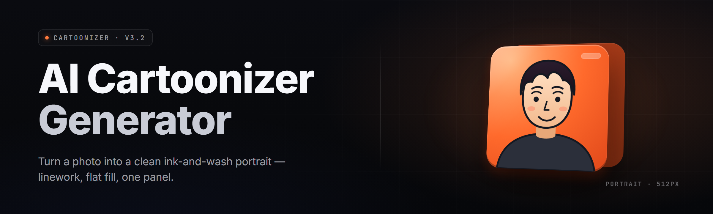

  
  
  

  

  
  

---

---

## 🧠 Overview

**AI Cartoonizer Generator** turns any photo, frame, or short clip into clean cartoon animation — cel-shaded, ink-outlined, palette-locked — on your own machine, with no cloud upload and no subscription. Drop a JPEG, get a cartoon. Drop an MP4, get a cartoon short. The whole pipeline runs locally on your GPU through a bundled ONNX runtime, and every style preset ships in the box.

This is the 2026 release line: faster diffusion-free stylization, a reworked line-extraction core, and a batch queue that actually survives a reboot.

| Category | Details |
|---|---|
| Product type | Desktop cartoonization suite (offline) |
| Distribution | Windows `.exe`, portable, no installer required |
| Core engine | ONNX Runtime + custom cel-shade / line-art graph |
| Input formats | JPG, PNG, WEBP, BMP, MP4, MOV, MKV, GIF |
| Output formats | PNG, JPG, WEBP, MP4, animated GIF, PNG sequence |
| GPU support | CUDA, DirectML, CPU fallback |
| Batch mode | Yes — folder in, folder out, resumable |
| License | MIT |

### 📦 Download

  

---

## 📚 Table of Contents

- [🧠 Overview](#-overview)
- [🖼️ What Is AI Cartoonization?](#️-what-is-ai-cartoonization)
- [🚩 The Problem](#-the-problem)
- [✅ The Solution](#-the-solution)
- [⚡ Quick Start](#-quick-start)
- [🧩 Key Features](#-key-features)
- [🎨 Style Engine Modules](#-style-engine-modules)
- [🧵 Line & Shading Modules](#-line--shading-modules)
- [🎬 Video & Animation Modules](#-video--animation-modules)
- [🗂️ Batch & Automation Modules](#️-batch--automation-modules)
- [🖥️ UI & Workflow Modules](#️-ui--workflow-modules)
- [📤 Export & Encoding Modules](#-export--encoding-modules)
- [🧮 Compatibility & Platform Support](#-compatibility--platform-support)
- [⚖️ Comparison](#️-comparison)
- [🧷 Known Issues](#-known-issues)
- [🔧 System Requirements](#-system-requirements)
- [🙋 FAQ](#-faq)
- [🛠️ Installation](#️-installation)

---

## 🖼️ What Is AI Cartoonization?

Cartoonization is the process of taking a photographic image and re-rendering it through a stylization graph so it reads like a hand-drawn or cel-shaded illustration: flattened color regions, drawn outlines, reduced noise, and a limited palette. The AI Cartoonizer Generator wraps that graph in a desktop app so you never touch a command line.

| Term | Explanation |
|---|---|
| Cel-shading | Flattens gradients into discrete color bands, like animation cells. |
| Line extraction | Detects and redraws edges as ink-style strokes. |
| Palette lock | Constrains output to a fixed color set for a consistent show look. |
| Style preset | A saved bundle of shading, line, palette, and grain settings. |
| Seed | A fixed number so the same input + preset always yields the same output. |
| Tile pass | Splits large images into overlapping tiles to fit GPU memory. |
| Frame interpolation | Smooths video by generating in-between frames before stylizing. |

Why people reach for it:

- Turn family photos into a cartoon short for a birthday.
- Storyboard a webcomic from phone snapshots without drawing every panel.
- Give indie game art a cel-shaded pass without commissioning an artist per frame.
- Convert raw reference footage into a consistent animation look for pitch decks.
- Batch a whole folder of product shots into a matching cartoon catalog.
- Keep every file on-disk — nothing leaves your machine.

---

## 🚩 The Problem

- Cloud cartoonizer sites upload your photos to servers you don't control, and many keep them.
- Most web tools cap resolution, add watermarks, or paywall the export button.
- Video cartoonization online is slow, throttled, and often limited to a few seconds per render.
- Desktop stylization tools are usually research scripts — no GUI, no batch, no presets.
- Style results are inconsistent between runs because seeds and settings aren't reproducible.
- No tool handles a mixed folder of photos *and* clips in one pass.
- GPU users get no acceleration path; everything falls back to a single CPU thread.

---

## ✅ The Solution

| Problem | Solution |
|---|---|
| Cloud uploads | Fully offline `.exe` — files never leave disk |
| Watermarks & paywalls | No watermarks, no export caps, MIT-licensed |
| Slow video renders | GPU graph + tiled passes + frame batching |
| Research-script UX | Purpose-built desktop GUI with drag-and-drop |
| Inconsistent styles | Seed locking + saved preset bundles |
| Mixed photo/video folders | Unified batch queue handles both |
| No acceleration | CUDA, DirectML, and CPU paths with auto-detect |

---

## ⚡ Quick Start

1. 🧲 Visit the project page and grab the current Windows build.
2. 📂 Extract the archive to any folder — no installer, no admin prompt.
3. 🖱️ Launch the `.exe` from the extracted folder.
4. 🖼️ Drop a photo or clip onto the window.
5. 🎨 Pick a style preset, hit **Cartoonize**, and export.

---

## 🧩 Key Features

| Feature | Description | Benefit |
|---|---|---|
| One-click cartoonize | Single button runs the full stylize graph | Zero learning curve |
| 38 built-in modules | Style, line, video, batch, UI, export | Depth without a manual |
| GPU auto-detect | Picks CUDA, DirectML, or CPU at launch | Works on any machine |
| Drag-and-drop queue | Drop folders, not just files | Fast bulk jobs |
| Seed locking | Fixed seed = reproducible output | Consistent series look |
| Preset bundles | Shading + line + palette + grain saved together | One-click house style |
| Live preview | GPU-accelerated 1:1 preview | See before you render |
| Batch resume | Queue survives crashes and reboots | Long jobs safe |
| Video cartoonize | Frame-accurate MP4/MOV/GIF pass | Animate without a studio |
| Palette lock | Fixed color set enforced across frames | Show-consistent color |
| No watermark | Output is clean at every resolution | Client-ready files |
| Portable build | Extract-and-run, no registry writes | USB-friendly |

---

## 🎨 Style Engine Modules

### **Cel & Flat Shading**

| Feature | Effect |
|---|---|
| Cel-band quantizer | Snaps gradients to N flat tone steps |
| Flat-fill solver | Replaces texture noise with solid regions |
| Edge-aware blur | Smooths inside regions, preserves borders |
| Tone curve mapper | Remaps luminance to a stylized ramp |

### **Palette Control**

| Feature | Effect |
|---|---|
| K-means palette | Extracts a fixed palette per image |
| Locked-palette mode | Forces a saved palette across a batch |
| Duotone mode | Two-color stylization for poster looks |
| Saturation clamp | Prevents oversaturated output |

### **Style Presets**

| Feature | Effect |
|---|---|
| Anime-cel preset | Hard outlines, flat fill, limited palette |
| Comic-ink preset | Heavy line weight, hatch shading |
| Watercolor preset | Soft bleed, low-contrast edges |
| Storybook preset | Warm palette, gentle outlines |
| Custom preset save | Store any combination as a reusable bundle |

---

## 🧵 Line & Shading Modules

### **Line Extraction**

| Feature | Effect |
|---|---|
| Sobel edge pass | Fast base edge detection |
| Canny refine | Cleaner, thinner contour lines |
| Line-weight control | Thickness slider for stroke width |
| Ink-jitter | Hand-drawn wobble on straight lines |

### **Shading**

| Feature | Effect |
|---|---|
| Hatch shader | Diagonal hatching for comic shadow |
| Shadow-map pass | Adds directional cel shadows |
| Rim-light pass | Highlights subject edges |
| Ambient occlusion | Adds depth under overhangs |

---

## 🎬 Video & Animation Modules

### **Frame Pipeline**

| Feature | Effect |
|---|---|
| Frame extractor | Pulls frames from MP4/MOV/MKV/GIF |
| Temporal smoothing | Reduces flicker between frames |
| Frame interpolation | Generates in-betweens for smooth motion |
| Audio passthrough | Keeps the original audio track |

### **Video Export**

| Feature | Effect |
|---|---|
| MP4 encoder | H.264/H.265 output |
| GIF exporter | Palette-optimized animated GIF |
| PNG sequence | Frame-by-frame output for compositing |
| CRF control | Quality/size tradeoff slider |

---

## 🗂️ Batch & Automation Modules

### **Queue Engine**

| Feature | Effect |
|---|---|
| Folder batch | Recursive folder-in / folder-out |
| Mixed-media queue | Photos and clips in one run |
| Resume after crash | Restarts from last completed item |
| Priority reorder | Drag queue items to reorder |

### **Automation**

| Feature | Effect |
|---|---|
| Watch-folder mode | Auto-process new files in a folder |
| CLI runner | Headless batch via bundled runner |
| Preset chaining | Apply multiple presets in sequence |
| Naming templates | Custom output filename patterns |

---

## 🖥️ UI & Workflow Modules

### **Interface**

| Feature | Effect |
|---|---|
| Drag-and-drop canvas | Drop files directly onto the window |
| Split view | Side-by-side original vs. cartoon |
| Before/after slider | Wipe to compare |
| Dark & light themes | Comfort at any hour |

### **Workflow**

| Feature | Effect |
|---|---|
| Undo/redo stack | Step back through adjustments |
| Preset favorites | Pin presets to the toolbar |
| Keyboard shortcuts | Fast navigation for power users |
| Session restore | Reopens last project on launch |

---

## 📤 Export & Encoding Modules

### **Image Export**

| Feature | Effect |
|---|---|
| PNG/JPG/WEBP | Standard image output |
| Resolution upscale | Optional post-stylize upscale |
| Metadata strip | Removes EXIF on export |
| Batch naming | Sequential or templated names |

### **Delivery**

| Feature | Effect |
|---|---|
| Output folder picker | Choose destination per job |
| Overwrite guard | Prevents accidental clobber |
| Export log | CSV of every processed file |
| Copy-to-clipboard | Quick single-image export |

---

## 🧮 Compatibility & Platform Support

| Component | Support |
|---|---|
| Windows 10 (21H2+) | ✅ Fully supported |
| Windows 11 | ✅ Fully supported |
| CUDA GPUs (NVIDIA) | ✅ Accelerated |
| DirectML GPUs (AMD/Intel) | ✅ Accelerated |
| CPU-only machines | ✅ Fallback path |
| Portable / USB run | ✅ No install needed |
| macOS / Linux | ❌ Not in this build |

---

## ⚖️ Comparison

| Aspect | Cloud Web Tools | Research Scripts | This Tool |
|---|---|---|---|
| Privacy | Files uploaded | Local | Fully offline |
| GUI | Yes | No | Yes |
| Video support | Capped/throttled | Manual | Native batch |
| Watermark | Often | No | Never |
| Reproducibility | Inconsistent | Manual seeds | Seed-locked |
| GPU acceleration | Server-side | DIY | Auto-detect |
| Batch folders | Rare | Scripted | Built-in |

---

## 🧷 Known Issues

| Issue | Fix |
|---|---|
| Preview stutters on 4K | Lower preview resolution in Settings |
| Video render flickers | Enable temporal smoothing |
| First launch slow | Shader cache warms on first run |
| DirectML crash on old drivers | Update GPU driver to latest |
| Batch resumes wrong file | Clear `.batchstate` in output folder |

---

## 🔧 System Requirements

| Component | Minimum | Recommended |
|---|---|---|
| OS | Windows 10 21H2 | Windows 11 23H2 |
| CPU | 4-core x64 | 8-core x64 |
| RAM | 8 GB | 16 GB+ |
| GPU | DirectX 12 capable | NVIDIA RTX / AMD RX |
| VRAM | 2 GB | 6 GB+ |
| Storage | 2 GB free | 10 GB free (video) |
| Display | 1280×720 | 1920×1080+ |

---

## 🙋 FAQ

| Question | Answer |
|---|---|
| Is it really offline? | Yes — the `.exe` never contacts a server. |
| Do I need a GPU? | No, but GPU makes video far faster. |
| Can it do video? | Yes — MP4, MOV, MKV, GIF input. |
| Does it watermark output? | Never, at any resolution. |
| Can I batch a whole folder? | Yes, recursive folder-in / folder-out. |
| Will my style stay consistent? | Lock the seed and palette across a batch. |
| Is there a CLI? | Yes — a bundled headless runner. |
| Do I need admin rights? | No — it's a portable build. |
| Can I run it from a USB stick? | Yes, no registry writes. |
| What license is it? | MIT. |

---

## 🛠️ Installation

1. **Get the build.** Open the project page and download the current Windows archive. No pip, npm, or git required.

2. **Extract.** Right-click the archive and extract to any folder — Desktop, a drive, or a USB stick. Keep the folder intact so the bundled runtime and presets stay together.

3. **Run.** Launch the `.exe` from the extracted folder. First launch warms the shader cache; after that it starts instantly. Drop a file and cartoonize.

---

## 📦 Download

  

---

That's the whole build — an offline cartoonizer that keeps your files yours and turns a folder of photos and clips into a matching cartoon set without a cloud bill. Grab it, extract it, and drop in your first image. Absolute potato to Sam, this one came out clean.
